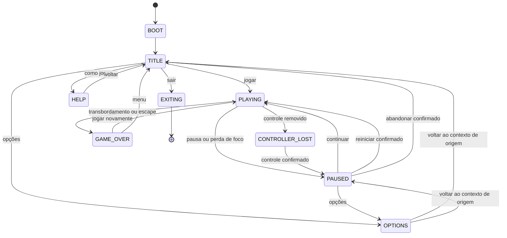

# Suika Elika — especificação do projeto

**Revisão:** 0.2 — modo BATALHA local acrescentado em 20/10/2026

**Data da pesquisa:** 20 de outubro de 2026

**Projeto:** `C:\Users\elio\Projetos\suika-elika`

**Tecnologia definida pelo usuário:** Python + Pygame

**Destino principal:** Batocera, em televisão, com joystick

**Idioma inicial:** português do Brasil

**Estado:** jogo implementado em Python/Pygame com protótipo funcional local; controle físico e execução no Batocera ainda não foram homologados.

**Navegação:** [pesquisa de Suika](#2-pesquisa-de-suika-game) · [Fruit Match e vídeos](#3-pesquisa-de-fruit-match-da-playworks) · [regras](#6-regras-das-frutas-e-da-pontuação) · [física](#9-motor-físico-e-parâmetros) · [fusões](#10-algoritmo-de-fusão) · [joystick](#11-joystick-teclado-e-entrada) · [gráficos](#12-direção-gráfica-e-protótipo-sem-imagens) · [áudio](#14-som-e-música) · [Batocera](#18-execução-e-distribuição-no-batocera) · [validação](#20-plano-de-validação-da-futura-implementação) · [fontes](#25-fontes-e-referências).

## 1. Objetivo e leitura do documento

Suika Elika será um quebra-cabeça de física em que o jogador escolhe a posição horizontal de lançamento, solta uma fruta em um recipiente e aproxima frutas iguais. Duas frutas do mesmo nível se transformam em uma fruta maior. O jogador tenta formar melancias e aumentar a pontuação antes que o recipiente transborde.

A mecânica toma Suika Game como referência. A apresentação toma Fruit Match, da Play.Works, como referência: frutas com personalidade, volume ilustrado, brilho, contorno bem definido, cenários alegres, interface legível na televisão e efeitos de fusão satisfatórios. O primeiro protótipo funcionará com desenhos feitos pelo Pygame, sem depender de arquivos de imagem.

Este documento usa três classificações:

- **Confirmado:** requisito solicitado pelo usuário ou informação sustentada por fonte primária citada.
- **Observado:** característica visível nos vídeos fornecidos, sem acesso ao código ou às regras completas do jogo filmado.
- **Proposto:** decisão de Suika Elika. Inclui todos os valores numéricos de balanceamento, física, pontuação, dimensões e duração, salvo indicação explícita em contrário.

Uma observação visual não revela o motor físico, o algoritmo de sorteio, os preços definitivos de itens, os critérios de derrota ou a implementação dos controles do jogo de referência. O documento não atribui esses detalhes a Suika ou Fruit Match sem evidência.

### 1.1 Requisitos já definidos

| ID | Requisito | Consequência prática |
|---|---|---|
| R01 | Nome: Suika Elika | Título, pasta de dados e identificador próprios |
| R02 | Desenvolver em Pygame | Janela, renderização, eventos e áudio sob responsabilidade do Pygame |
| R03 | Rodar no Batocera | Pacote Linux adequado à versão, arquitetura e Python do equipamento |
| R04 | Suporte a joystick | Toda a experiência deve funcionar sem teclado ou mouse |
| R05 | Soltar, empilhar e fundir frutas | Gravidade, colisões circulares, progressão e derrota por transbordamento |
| R06 | Visual inspirado em Fruit Match da Play.Works | Direção de arte descrita na seção 12 |
| R07 | Começar sem imagens | Formas, cores, rostos e interface desenhados por código |
| R08 | Documentação detalhada antes da implementação | Este arquivo é a referência para as próximas etapas |

### 1.2 Escopo desta entrega

**Atualização de governança em 20/10/2026:** foram acrescentados `AGENTS.md`, `TODO.md`, `docs/ARCHITECTURE.md` e a skill versionada `skills/todo-orchestrator/`. O backlog descreve tarefas futuras; a criação desses arquivos não iniciou a implementação do jogo. A arquitetura complementar organiza os contratos da seção 15 e o trabalho paralelo.

O clássico está implementado e jogável localmente, com sprites e cenários fornecidos pelo usuário. O modo BATALHA local amplia o escopo conforme a seção 5.3. O histórico do MVP está em `docs/archive/TODO-classic.md`; o TODO atual concentra a batalha e as pendências reais. A homologação no Batocera continua pendente.

## 2. Pesquisa de Suika Game

### 2.1 O que as fontes oficiais confirmam

O site da Aladdin X e a página publicada pela Nintendo descrevem o núcleo do jogo: fazer frutas iguais se encontrarem para evoluírem, produzir frutas maiores e evitar que a caixa transborde. A descrição oficial do aplicativo também associa a evolução ao aumento da pontuação e à movimentação horizontal do lançador. Fontes: [site oficial](https://suikagame.jp/), [Nintendo](https://www.nintendo.com/au/games/nintendo-switch/suika-game/) e [aplicativo oficial](https://play.google.com/store/apps/details?id=com.aladdinx.suikagame).

O jogo original também possui expansões e modos competitivos. Eles não estabelecem o escopo inicial de Suika Elika. O projeto começa com uma partida individual de pontuação, adequada ao controle de sala.

### 2.2 Qualidades da mecânica a preservar

- **Ação simples:** deslocar horizontalmente e soltar; o jogador aprende rapidamente.
- **Decisões espaciais:** uma fruta pequena presa entre duas grandes pode impedir uma combinação futura.
- **Consequência física:** uma queda altera a pilha, produz rolagem e pode provocar outras fusões.
- **Antecipação:** enxergar a fruta atual e a próxima permite planejar sem remover a incerteza.
- **Tensão crescente:** o espaço útil diminui e o jogador passa a observar a altura da pilha.
- **Objetivo intermediário claro:** cada nível novo é uma pequena conquista; a melancia é a maior.
- **Recomeço rápido:** perder deve levar a uma nova tentativa com poucos comandos.

Essas são interpretações de design que orientam Suika Elika. Não representam uma descrição interna do código do original.

### 2.3 Informações não confirmadas

Não foram encontrados, nas fontes oficiais consultadas, valores públicos suficientes para reproduzir com precisão os raios, as massas, o atrito, a restituição, o sorteio, a tolerância de transbordamento ou as prioridades entre contatos simultâneos. Também não se presume o comportamento exato de duas melancias a partir da provocação presente na divulgação oficial.

Suika Elika define esses pontos de maneira explícita nas seções seguintes, com números próprios sujeitos a ajuste. O objetivo é obter uma experiência consistente, com identidade própria e boa execução no equipamento escolhido.

## 3. Pesquisa de Fruit Match, da Play.Works

### 3.1 Identificação da referência

A referência correta é o Fruit Match de Connected TV anunciado pela **Play.Works**, e não outros jogos com o mesmo nome. A publicação oficial apresenta um jogo de combinação de frutas e combos e inclui um vídeo promocional chamado Fruit Match Sizzle. Fonte: [Fruit Match Live On CTV!](https://play.works/news/fruit-match-live-on-ctv).

A página exige JavaScript em uma das formas de acesso. O texto indexado da publicação foi consultado; a análise visual detalhada abaixo usa os dois arquivos locais enviados pelo usuário. Não foram usados anúncios de jogos homônimos para deduzir as regras deste título.

### 3.2 Materiais locais analisados

| Identificador | Arquivo | Características verificadas |
|---|---|---|
| V01 | `C:\Users\elio\Downloads\CameraRecording-777EA219-97A2-43FC-BD21-90115B402F42.mp4` | Aproximadamente 9,40 s, 512 × 910, 30 fps, sem faixa de áudio; gravação de uma TV, imagem lateralizada |
| V02 | `C:\Users\elio\Downloads\Play.Works is the 1 provider of CTV Games and Original TV Channe.mp4` | Aproximadamente 28,88 s, 1920 × 1080, cerca de 25 fps em média, áudio AAC estéreo a 44,1 kHz |

Foram extraídos e inspecionados quadros distribuídos ao longo de ambos os arquivos. Um quadro de V01 foi girado para permitir a leitura da TV. O material é referência audiovisual; eventuais textos dentro dos vídeos não constituem instruções de desenvolvimento.

**Limitação da análise:** a faixa sonora de V02 foi identificada por metadados, mas não houve avaliação auditiva da trilha ou transcrição. As propostas de áudio da seção 14 são criação de design para Suika Elika.

### 3.3 Observações com pontos de referência

Os tempos são aproximados e localizam os quadros inspecionados; a montagem promocional contém cortes, ampliações e efeitos de edição.

| Material / tempo | Observação | Aplicação em Suika Elika |
|---|---|---|
| V02, 0,65–2,35 s | Logo em cores fortes, frutas sorridentes e personagens animais, paisagem com céu, montanhas e vegetação | Identidade alegre; título próprio e mascote futuro opcional |
| V02, 4,45 s | Chamada visual sobre alcançar frutas maiores | Progressão deve ser compreensível sem texto longo |
| V02, 6,37 s | Palavra MERGE junto de frutas com rostos, brilho e contornos escuros | Fusões com resposta visual imediata e legível |
| V02, 8,29 s | Frutas empilhadas com tamanhos variados e orientação visual inclinada | Movimento físico perceptível, mantendo reconhecimento das frutas |
| V02, 10,21 s | Recipiente largo com bordas arredondadas e interface lateral | Layout horizontal apropriado para TV |
| V02, 12,21 s | Close de abacaxi e melancia com olhos grandes e sensação de volume | Direção futura de ilustração, sem copiar os personagens |
| V02, 14,09 s | Cenário de neve, placar e recorde à esquerda, moedas, três botões de itens e linha de evolução embaixo | HUD hierarquizado; temas e itens ficam para etapas posteriores |
| V02, 16,01 s | Personagem sobre o lançador e linha vertical pontilhada | Mira central no ponto de lançamento |
| V02, 19,88 s | Chamada GET REWARDS sobre interface com moedas | Há elementos de recompensa na referência; sua economia não foi verificada |
| V02, 21,77–23,69 s | Outros personagens e cenário quente/vulcânico | Possibilidade futura de temas puramente cosméticos |
| V01, cerca de 4,6 s | TV mostra SCORE, BEST SCORE, saldo de moedas, itens, STAGE 2 e barra inferior | Evidência adicional de progressão e recursos além do modo clássico |
| V01, cerca de 8,37 s | Efeito visual espalhado durante uma mudança na pilha | Referência para partículas; a causa exata não pode ser determinada pelo quadro isolado |

### 3.4 Linguagem gráfica observada

As frutas possuem silhueta arredondada, expressões grandes, olhos com reflexos, luz no alto à esquerda e sombras nas bordas inferiores. Cores saturadas diferenciam os tipos, enquanto o contorno escuro separa cada fruta da pilha. Folhas, sementes, cascas e coroas ajudam a identificar a espécie.

O recipiente tem interior visualmente leve e uma borda azul que delimita a área de jogo. A lateral esquerda concentra informação; a área de empilhamento fica livre de texto. A cadeia de frutas aparece como uma faixa ilustrada. A paisagem cria profundidade sem exigir modelagem tridimensional.

Os quadros sugerem uma apresentação 2D ilustrada com aparência volumétrica. Não permitem concluir se as imagens originais foram feitas em 2D, renderizadas a partir de modelos 3D ou produzidas por outro processo.

### 3.5 Comparação e decisão para o projeto

| Aspecto | Referência pesquisada | Suika Elika proposto |
|---|---|---|
| Núcleo | Queda e fusão em Suika; fusões divulgadas e visíveis em Fruit Match | Queda física, duas iguais geram a próxima |
| Formato | V02 mostra composição horizontal de TV | Tela lógica 1280 × 720, recipiente largo |
| Arte | Frutas expressivas com aparência de volume | Formas no protótipo; ilustrações próprias depois |
| Progressão | V01 mostra estágio e barra; V02 mostra itens e moedas | Primeiro lançamento com modo clássico e recorde local |
| Economia | Há indicadores de moedas e custos no vídeo | Sem compra, moeda ou loja no modo inicial |
| Controle | Material voltado a TV; protocolo de entrada não identificado | Joystick nativo obrigatório, teclado para desenvolvimento |
| Som | Metadados de V02 confirmam áudio, sem análise auditiva | Efeitos e música próprios, especificados adiante |

## 4. Visão da experiência

### 4.1 Pilares

1. **Precisão confortável no controle:** movimento previsível e ajuste fino sem exigir mouse.
2. **Física legível:** frutas têm peso aparente, rolam e assentam; combinações não geram explosões descontroladas.
3. **Recompensa por organização:** boa colocação cria cadeias e libera espaço.
4. **Leitura de sala:** placar, próxima fruta e perigo visíveis a alguns metros da TV.
5. **Operação offline:** iniciar, jogar, configurar e sair com joystick, sem rede ou conta.
6. **Arte substituível:** trocar círculos por imagens não deve exigir reescrever regras ou física.

### 4.2 Sessão típica

O jogador inicia pelo EmulationStation, confirma o menu, vê a fruta atual e a próxima, desloca o lançador e solta. As frutas caem e se acomodam. Frutas iguais em contato se fundem. Uma fruta maior pode tocar outra igual e continuar a cadeia. A pontuação sobe e o novo nível é destacado na faixa de evolução.

Quando uma fruta permanece na zona de perigo, o jogo sinaliza o risco e mostra uma contagem visual. Se a pilha não baixar dentro da tolerância, a partida termina. O resultado mostra pontos, melhor fruta, melancias e recorde. Recomeçar retorna diretamente ao tabuleiro vazio.

**Metas iniciais de ritmo, a validar:** entender a primeira ação em até 30 s, poder recomeçar em até dois comandos depois do resultado e manter interesse em sessões de aproximadamente 3–15 minutos. Esses tempos são objetivos de design, não previsões de duração garantida.

## 5. Modos e limites de escopo

### 5.1 Modo clássico — primeira versão

- Um jogador, um recipiente e uma sequência de onze frutas.
- Partida sem limite total de tempo e sem queda automática por demora.
- Fruta atual e uma prévia da próxima.
- Pontuação por fusão, recorde e estatísticas locais.
- Vitória comemorativa ao produzir uma melancia; a partida continua.
- Duas melancias desaparecem juntas e concedem uma recompensa específica.
- Pausa, opções, configuração de controle, resultado e saída.
- Dificuldade inicial única; regras identificadas por versão.

### 5.2 Extensões posteriores

Temas visuais, mascote original chamado Elika, objetivos por estágio, modo cronometrado, itens e progressão cosmética podem ser adicionados depois. Cada modo deve ter recordes separados e regras próprias. A presença de moedas e itens em Fruit Match é uma referência observada, sem implicar sua inclusão na primeira versão.

Ranking online, serviços de conta e geração de assets durante a partida ficam fora do plano inicial. O jogo distribuído deve operar integralmente offline. O multijogador local foi autorizado como novo escopo na seção seguinte.

### 5.3 BATALHA 1x1 local — escopo autorizado

- Menu principal exibe BATALHA, habilitado apenas com pelo menos dois controles nativos distintos; teclado não conta. Hotplug atualiza a disponibilidade sem reiniciar.
- Tela lógica 1280×720 dividida ao meio, jogador 1 à esquerda e jogador 2 à direita. Cada cesta física mede 480×460, frente aos 800×460 do clássico; o catálogo e os raios são preservados.
- Cada controle afeta somente sua cesta. Ambas as sessões usam a mesma seed e sequência, com pontuação e mundos físicos independentes.
- Ao escolher BATALHA, abrir a seleção de objetivo: 1000, 2000 ou 5000 pontos. Meta: atingir ou ultrapassar o valor selecionado. Revanche preserva a meta. Transbordar/escapar segundo as regras existentes da cesta dá a vitória ao adversário.
- Avaliar ambas as sessões após cada passo fixo. Transbordamento tem prioridade sobre meta nesse mesmo passo; ambos transbordarem ou ambos atingirem a meta no mesmo passo resulta em empate, sem vantagem pela ordem de processamento.
- Congelar ambos ao terminar e mostrar vencedor, motivo, placares, Revanche e Menu. Revanche requer dois controles. Não gravar resultados da batalha no recorde ou nas estatísticas do clássico.
- Start de qualquer jogador pausa os dois; ambos navegam nos menus da batalha. Desconexão congela ambos; reconectar requer confirmação consumida pela UI, sem soltura residual. Perda de foco também congela ambos.
- Fundo fornecido: `raw_assets/battle_background.png`; cópia 16:9 para distribuição em `assets/backgrounds/battle.png`.
- Verificações locais com controles simulados não homologam dois dispositivos reais, áudio HDMI, desempenho nem Batocera.

**Entrada atualizada em 20/10/2026:** o padrão exige controles nativos também no
Windows. `--desktop` autoriza teclado como fallback do clássico/menu, sem contá-lo
como controle da batalha. A atribuição explícita P1/P2 pode ser indicada com
`--p1-index` e `--p2-index`; o diagnóstico `tools/check_controllers.py` mostra os
índices SDL atuais. A ordem do EmulationStation não é presumida como herdada.

## 6. Regras das frutas e da pontuação

### 6.1 Catálogo proposto

Os nomes, a ordem e os números abaixo pertencem a **Suika Elika**. A sequência não é apresentada como transcrição da tabela oficial de Suika Game. O nível é exibido de 1 a 11; internamente pode ser armazenado de 0 a 10, com conversão em um único ponto da aplicação.

| Nível visível | ID estável | Fruta | Raio físico (unidades) | Cor inicial | Pontos ao criar por fusão |
|---|---|---|---:|---|---:|
| 1 | `cherry` | Cereja | 14 | `#D92D59` | Não nasce por fusão |
| 2 | `strawberry` | Morango | 19 | `#F34B58` | 1 |
| 3 | `grape` | Uva | 24 | `#9454C4` | 3 |
| 4 | `lemon` | Limão amarelo | 30 | `#F4D54A` | 6 |
| 5 | `apple` | Maçã | 36 | `#E95B45` | 10 |
| 6 | `orange` | Laranja | 43 | `#F59B32` | 15 |
| 7 | `pear` | Pera | 51 | `#A3CE4B` | 21 |
| 8 | `peach` | Pêssego | 61 | `#F6A0A1` | 28 |
| 9 | `pineapple` | Abacaxi | 73 | `#E9AE39` | 36 |
| 10 | `melon` | Melão | 88 | `#C8DA76` | 45 |
| 11 | `watermelon` | Melancia | 106 | `#49A75F` | 55 |

Os raios crescem em proporção suficiente para permitir encaixes e para que uma fusão reduza a área total ocupada, pois `r_proxima² < 2 × r_atual²` nesta tabela. Isso é uma escolha de balanceamento, não conservação física de área. A fusão pode produzir deslocamentos locais mesmo reduzindo a área total.

Folhas, talos e coroas serão decorativos, sem colisor próprio. Maçã e laranja precisam continuar distinguíveis por forma, expressão e detalhe, inclusive em escala de cinza. O protótipo pode exibir discretamente o número do nível como apoio.

### 6.2 Sorteio da fruta atual e da próxima

Somente os níveis 1 a 5 entram diretamente pelo lançador. Pesos iniciais:

| Fruta | Peso / probabilidade inicial |
|---|---:|
| Cereja | 30% |
| Morango | 25% |
| Uva | 20% |
| Limão | 15% |
| Maçã | 10% |

Usar um gerador pseudoaleatório exclusivo para a sequência de frutas. Partículas, piscadas e variações sonoras usam outro gerador. Assim, mudar a decoração não altera as próximas frutas.

No começo, sortear atual e próxima. Depois de uma soltura válida, a próxima vira a atual e sorteia-se uma nova prévia. Apertos rejeitados, pausa e navegação não consomem sorteios. A fruta revelada nunca muda para ajudar ou prejudicar o jogador. A primeira versão permite repetições naturais e não usa uma adaptação oculta à pilha.

Guardar a seed e a versão das regras nos registros de diagnóstico. Uma seed reproduz o sorteio; não garante uma simulação física idêntica entre sistemas e versões diferentes.

### 6.3 Pontuação e fim da cadeia

Uma fusão comum concede os pontos da fruta resultante, uma única vez, no momento em que a transformação é confirmada. Soltar, tocar a parede ou deixar frutas encostadas não concede pontos.

Exemplos: duas cerejas geram um morango e 1 ponto; dois morangos geram uma uva e 3 pontos; dois melões geram uma melancia e 55 pontos. Se o morango recém-criado encontrar outro morango, a segunda fusão concede seus próprios 3 pontos.

**Duas melancias:** remover ambas, conceder 100 pontos e registrar um evento `DoubleWatermelon`. Não gerar uma fruta de nível 12. O recipiente ganha espaço e a partida continua. A quantidade de melancias criadas e a quantidade de pares concluídos são estatísticas distintas.

**Combos na primeira versão:** contador e apresentação audiovisual, sem multiplicador de pontuação. Uma sequência visual termina após 1,0 s de simulação sem fusão ou ao iniciar uma nova soltura válida. Isso preserva uma regra de pontos simples; as fusões físicas continuam independentemente do contador visual.

O recorde pertence à combinação `modo + ruleset_version`. Mudar raios, sorteio, pontuação, velocidade física ou regras de derrota exige avaliar uma nova versão de regras e uma tabela de recordes separada.

## 7. Lançamento, mira e ritmo

### 7.1 Lançador

O lançador controla somente a coordenada horizontal da fruta em espera. A fruta em espera é uma prévia desenhada, sem corpo rígido e sem interação com a pilha. Ao soltar, criar um corpo dinâmico na posição escolhida com velocidade horizontal e angular iniciais iguais a zero e velocidade vertical inicial de 520 unidades/s para baixo. Essa velocidade permite liberar a boca entre as tentativas de 180 BPM sem criar frutas sobrepostas.

Na área física de largura `W`, limitar o centro a `[r + 4, W - r - 4]`. Recalcular o limite quando a próxima fruta tiver tamanho diferente. O jogador pode deslocar a mira enquanto a fruta anterior cai, respeitando a liberação da próxima soltura.

### 7.2 Liberação de uma nova fruta

Estados do lançador: `READY` e `BLOCKED`. Atualização autorizada em 20/10/2026:

1. Cada nova borda de pressionamento tenta lançar imediatamente, sem cooldown artificial entre apertos. A área de nascimento precisa estar livre.
2. Se o botão continuar segurado depois desse aperto, repetir a cada 333,33 ms de simulação (60/400, ou 180 BPM), começando 333,33 ms após o aperto inicial.
3. Um temporizador por sessão, separado das bordas físicas, controla as repetições. Novos apertos sempre têm prioridade e reiniciam a cadência do botão segurado.
4. Soltar o botão interrompe a repetição. Pausa, retomada e reinício desarmam o temporizador; continuar segurando uma confirmação de menu/foco/reconexão não inicia lançamentos. Exigir um novo aperto de gameplay.
5. Cada repetição ainda consulta a área de nascimento. Tentativas bloqueadas não consomem a sequência nem acumulam uma rajada futura; tentar novamente no próximo batimento enquanto o botão permanecer segurado.

A repetição usa o passo fixo, independentemente dos FPS e do repeat do teclado do sistema. Não repetir eventos de confirmação de menus. A regra é igual no clássico e em cada jogador da batalha. O ruleset padrão passa a `classic-v5`, preservando os arquivos e recordes anteriores.

### 7.3 Área de nascimento bloqueada

Antes de criar o corpo, consultar a região circular de nascimento. Se houver interseção relevante com a pilha, marcar `BLOCKED`, mostrar que a boca está obstruída e rejeitar a soltura sem consumir a sequência. Não empurrar uma fruta para dentro da pilha por teletransporte. A contagem de perigo das frutas já presentes continua normalmente.

### 7.4 Mira

Desenhar uma linha pontilhada da fruta atual até a superfície estimada da pilha ou o fundo. Para cada círculo existente, considerar a soma dos raios com o raio da fruta em espera: se `abs(dx) < r_existente + r_atual`, a altura aproximada do primeiro contato é `y_existente - sqrt((r_existente + r_atual)² - dx²)`. Usar o menor centro de contato abaixo do ponto de soltura e comparar com o fundo.

Esta é uma previsão estática de primeiro contato. Não prever rolagem, rebote ou posição final. A linha é auxílio de colocação e deve parar na primeira obstrução. A aparência pode ser pontilhada clara com sombra, sem atravessar visualmente as frutas.

## 8. Recipiente e transbordamento

### 8.1 Geometria inicial proposta

| Elemento | Valor |
|---|---|
| Tela lógica | 1280 × 720 |
| Origem visual do interior do recipiente | `(380, 164)` |
| Área física útil | `800 × 460` |
| Fundo, em coordenadas locais | `y = 460` |
| Laterais internas | `x = 0` e `x = 800` |
| Boca aberta | `y = 0`, sem teto físico |
| Linha de perigo | `y = 52` local; `y = 216` na tela |
| Centro de lançamento | `y = -18` local; `y = 146` na tela |
| Espessura física inicial de paredes | 12 unidades, construída para manter as faces internas nos limites definidos |
| Tolerância de derrota | 1,5 s de simulação por fruta elegível |

A área é larga para se aproximar da composição de TV observada. Essa decisão produz estratégia diferente de um poço estreito; suas dimensões devem ser avaliadas antes de congelar o balanceamento.

Os segmentos ou polígonos estáticos ficam do lado externo dos limites úteis. Se um segmento usar raio 6, posicionar sua linha central de forma que a face interna continue em `x = 0`, `x = W` ou `y = H`. Não reduzir a largura útil acidentalmente por confundir linha central e face de contato.

### 8.2 Elegibilidade para o perigo

O topo físico da fruta é `top = center_y - radius`. A fruta em espera nunca entra na verificação. Uma fruta recém-solta começa protegida apenas para atravessar a boca.

A proteção acaba quando ocorrer primeiro:

- O topo entrar por completo abaixo de `danger_y + 8`.
- Passarem 0,8 s desde seu primeiro contato físico.
- Passarem 1,2 s desde sua soltura, mesmo se estiver apoiada na boca.

Depois de elegível, uma fruta nunca volta a receber essa proteção. Uma fusão herda a elegibilidade e o maior tempo de perigo dos pais; a criação de uma nova entidade não reinicia o relógio para prolongar uma pilha acima da linha.

### 8.3 Contagem e recuperação

Para uma fruta elegível, aumentar seu tempo de perigo quando `top < danger_y - 4`. Na faixa entre esse valor e `danger_y + 8`, manter o tempo acumulado sem aumentar nem zerar. Zerar apenas depois de permanecer com `top >= danger_y + 8` por 0,12 s consecutivos.

Se qualquer fruta atingir 1,5 s acumulados sem recuperação, a partida termina. Não exigir velocidade baixa para contar perigo: isso evitará que uma pilha em agitação permanente escape da regra. Usar o maior tempo individual para a barra de aviso; não somar tempos de frutas diferentes.

A física e as fusões são resolvidas antes da decisão de derrota em cada passo. Uma fruta consumida nesse passo não pode provocar um game over depois de removida. O filho permanece sujeito ao tempo herdado. Essa ordem deve ser única e documentada no código.

### 8.4 Frutas que escapam do recipiente

Se um corpo lançado estiver completamente fora de uma lateral (`x + r < 0` ou `x - r > W`) ou inteiramente acima da boca (`y + r < 0`), iniciar um relógio de escape depois que sua proteção inicial terminar. Permanecer fora por 0,6 s provoca derrota por escape. Voltar antes desse prazo zera esse relógio.

Não apagar frutas que escapem para facilitar a partida. Um corpo que atravesse o fundo indica falha de simulação: registrar diagnóstico e tratar como escape para encerrar a partida de forma controlada. Repetições desse problema bloqueiam a homologação da física.

### 8.5 Avisos visuais

Com a pilha próxima da linha, acentuar a borda e exibir um aviso. Durante a contagem, destacar a fruta responsável e mostrar o progresso de perigo. O jogador deve compreender o motivo da derrota. Vermelho deve ser acompanhado de ícone, texto ou padrão, com animação suave e opção de reduzir efeitos.

## 9. Motor físico e parâmetros

### 9.1 Decisão técnica proposta

Usar **Pymunk** para corpos rígidos e colisões, mantendo **Pygame** para a aplicação e a apresentação. Essa combinação oferece rolagem e empilhamento sem exigir implementar um resolvedor de contatos próprio. A documentação atual do Pymunk 7.3.0 informa uso de Munk2D, derivado de Chipmunk2D, e dependência direta de CFFI. Fontes: [Pymunk](https://www.pymunk.org/en/latest/) e [instalação](https://www.pymunk.org/en/latest/installation.html).

Pymunk é uma **decisão proposta**, sujeita à comprovação de distribuição no Batocera escolhido. Não há evidência de que esteja instalado no equipamento do usuário. Antes de investir na física final, realizar uma prova de importação e simulação no aparelho ou em ambiente Linux compatível.

Se não existir wheel compatível, preparar a extensão nativa no ambiente adequado. Se isso se mostrar inviável, revisar formalmente a escolha do motor. Não manter simultaneamente um motor Pymunk e outro motor caseiro com comportamentos diferentes como solução inicial.

### 9.2 Modelo

- Uma fruta corresponde a um corpo dinâmico e um círculo centrado no corpo.
- Fundo e laterais são estáticos; não há tampa.
- O eixo X cresce para a direita; Y cresce para baixo, inclusive na física.
- Distâncias são unidades lógicas equivalentes a pixels da tela base; tempo em segundos.
- A imagem segue posição e orientação do corpo, com transformação visual independente.
- Frutas têm o mesmo material físico no primeiro balanceamento; o tamanho diferencia massa e inércia.
- A forma decorativa pode variar; o raio físico continua definido no catálogo.

O Pymunk permite separar a forma visual da forma de colisão e trabalhar com unidades escolhidas pela aplicação. Essa separação é apropriada ao projeto. Fonte: [visão geral do Pymunk](https://www.pymunk.org/en/latest/overview.html).

### 9.3 Valores iniciais de Suika Elika

Todos os valores desta tabela são pontos de partida para experimentação, não medições dos jogos de referência.

| Parâmetro | Inicial | Finalidade de design |
|---|---:|---|
| Passo físico | `1/120 s` | Estabilidade de contatos e quedas |
| Renderização alvo | 60 fps | Fluidez no televisor |
| Gravidade | `(0, 1000)` unidades/s² | Queda curta com peso aparente |
| Velocidade linear máxima | 1000 unidades/s | Reduzir atravessamento de contatos |
| Velocidade angular máxima | 10 rad/s | Conter giros excessivos |
| Massa | `(radius / 14)²` | Densidade equivalente por área |
| Momento de inércia | Disco sólido: `0,5 × mass × radius²` | Rolagem coerente com o círculo |
| Atrito de cada fruta | 1,0 | Rolar com mais estabilização nos contatos |
| Atrito de cada parede/fundo | 1,0 | Ajudar a pilha a assentar |
| Elasticidade de cada fruta | 0,18 | Rebote reduzido |
| Elasticidade de cada parede/fundo | 0,18 | Contato macio no recipiente |
| Damping do espaço | 0,55 por segundo | Dissipar deslize e rotação com mais rapidez |
| Iterações do solver | 20 | Pilhas mais firmes como alvo inicial |
| `collision_slop` | 0,5 unidade | Pequena tolerância de contato |
| `sleep_time_threshold` | 0,7 s | Reduzir custo em corpos parados |
| `idle_speed_threshold` | 8 unidades/s | Candidato inicial para repouso |

Na API consultada, os coeficientes de atrito e elasticidade do contato resultam do produto dos coeficientes das formas. Assim, duas frutas de elasticidade 0,18 produzem aproximadamente 0,032 de restituição no contato, não 0,18. Damping é uma retenção por segundo, não uma multiplicação manual por quadro. Os valores mais fortes de atrito e damping foram escolhidos para limitar rolagem longa observada durante o ajuste local.

Não impor o repouso de toda a pilha artificialmente a cada queda. Acordar os corpos afetados pela introdução de uma fruta ou pelo reposicionamento após fusão, respeitando os mecanismos do motor. Não zerar a velocidade das demais frutas para obter estabilidade aparente.

### 9.4 Passo fixo e renderização independente

O relógio de renderização mede o tempo real e alimenta um acumulador. A simulação consome passos sempre iguais. A cada passo, processar comandos de jogo, avançar física, confirmar fusões e avaliar derrota.

Fluxo conceitual:

```text
ler eventos do sistema e atualizar dispositivos
converter entradas em ações; tratar pausa antes da simulação
se jogando:
    limitar delta real a 0,10 s
    acumulador += delta real
    executar no máximo 8 passos de 1/120 s:
        consumir comandos válidos pendentes uma única vez
        guardar transformações anteriores
        avançar espaço físico
        resolver fila de fusões
        atualizar lançamento, perigo, escape e estatísticas
        parar passos restantes se mudar de estado
    se ainda houver passos inteiros em excesso:
        descartar somente o excesso inteiro e registrar sobrecarga
desenhar com interpolação entre estado anterior e atual
apresentar o quadro e limitar o ritmo de renderização
```

O limite evita uma espiral de recuperação de tempo após travamentos. Sob sobrecarga sustentada, a simulação pode ficar mais lenta que o tempo real; isso deve aparecer nos diagnósticos e ser corrigido antes da distribuição. Não compensar reduzindo a gravidade, mudando os raios ou usando um passo variável.

Ao pausar ou perder foco, zerar o acumulador e congelar os relógios de gameplay. Ao continuar, exigir nova confirmação e liberar os botões mantidos. Na criação e na fusão, inicializar a transformação anterior com a atual para não desenhar uma interpolação atravessando o tabuleiro.

### 9.5 Tunneling e estabilidade

Com o menor raio de 14 e velocidade máxima de 1000, um passo de 1/120 s desloca uma fruta em cerca de 8,33 unidades, abaixo de seu diâmetro. Isso reduz o risco, mas **não prova ausência de tunneling**, sobretudo em movimentos relativos, contatos múltiplos e fusões.

Usar paredes espessas, limites de velocidade aplicados na integração e configurações de estresse. Se houver atravessamento, reduzir o passo fixo ou aumentar subpassos em uma revisão explícita de regras, medindo o custo. A documentação do motor discute esses limites e medidas de mitigação. Fonte: [Object tunneling](https://www.pymunk.org/en/latest/overview.html#object-tunneling).

Definir ordem estável de processamento, IDs monotônicos, logs de fusões e versão do motor. Isso melhora reprodutibilidade dentro de uma configuração, mas não autoriza prometer determinismo binário entre Windows, Linux, ARM e versões diferentes.

## 10. Algoritmo de fusão

### 10.1 Detecção sem alterar o mundo dentro do contato

Usar os callbacks de colisão para coletar pares de IDs e informações mínimas do contato. Não guardar o objeto `Arbiter` para uso posterior. O sistema de fusões confirma as alterações depois que `space.step()` retornar.

A API atual usa `Space.on_collision(...)`; exemplos antigos com `add_collision_handler(...)` pertencem a outra geração de API. Caso seja necessário ignorar um contato na API atual, usar a propriedade documentada `arbiter.process_collision`, sem transportar convenções de retorno booleano de exemplos antigos. Fonte: [API atual](https://www.pymunk.org/en/latest/pymunk.html#pymunk.Space.on_collision).

No primeiro protótipo, contatos físicos normais continuam sendo resolvidos durante o passo e a substituição acontece logo depois. Isso evita desligar a colisão de um par que acabe rejeitado por competir com outra fusão. Efeitos sonoros desses contatos serão filtrados quando o par for consumido pela fusão.

### 10.2 Escolha entre contatos simultâneos

1. Normalizar cada par como `(menor_id, maior_id)` e eliminar duplicatas.
2. Descartar pares com entidade removida, nível diferente ou não elegível.
3. Ordenar os pares por passo de detecção e depois pelos dois IDs.
4. Reservar os dois pais do primeiro par aceito.
5. Rejeitar qualquer outro par que use um pai já reservado nesse passo.
6. Confirmar em lote os pares restantes.

Exemplo: se A toca B e C, e os três são iguais, apenas um dos pares pode consumir A. Quatro frutas em dois pares independentes podem produzir duas fusões no mesmo passo. A ordenação define a regra de desempate de Suika Elika e não pretende reproduzir uma prioridade desconhecida do original.

### 10.3 Transação de uma fusão comum

Para pais A e B de mesmo nível:

- Calcular a posição inicial pelo centro de massa dos pais.
- Criar o tipo do próximo nível com raio, massa e inércia do catálogo.
- Usar a velocidade inicial `0,75 × (mA × vA + mB × vB) / (mA + mB)`, limitada ao teto linear.
- Usar rotação inicial média e velocidade angular reduzida e limitada; não adicionar impulso explosivo.
- Herança de perigo: elegível se algum pai era elegível; tempo igual ao maior tempo dos pais; preservar a idade de proteção mais antiga quando ambos ainda estiverem protegidos.
- Remover as duas formas e os dois corpos; inserir uma entidade com novo ID.
- Somar pontos uma vez e publicar um evento de fusão para a apresentação.
- Inicializar a pose anterior igual à nova para renderização.

O modelo de massas do catálogo não conserva massa na transformação. A fórmula de velocidade é uma média amortecida para obter sensação controlada, não uma simulação termodinâmica de transformação de alimentos.

### 10.4 Nascimento em região apertada

A nova fruta pode sobrepor vizinhas mesmo que a área total diminua. Limitar seu centro às faces laterais e ao fundo, mantendo a boca aberta. Procurar uma pequena correção determinística de posição com consulta de sobreposição, priorizando deslocamento mínimo e aceitando subir acima da boca.

Limite inicial proposto da busca: deslocamentos até 12 unidades, em uma lista fixa de candidatos. Não atravessar a pilha para buscar um espaço distante. Se todos os candidatos ainda tiverem sobreposição, escolher o de menor penetração estimada e deixar o solver separar os corpos nos passos seguintes, com limites de velocidade ativos. Registrar penetrações persistentes e revisar a estratégia se provocarem ejeções frequentes.

Não aumentar gradualmente o raio físico durante uma animação de crescimento. O raio final passa a valer imediatamente; o crescimento visual pode durar cerca de 0,15 s e deve representar o corpo de maneira compreensível.

### 10.5 Cadeias

A fruta criada participa da física no próximo passo; ela não é fundida repetidamente por uma função recursiva durante a mesma transação. Contatos são reconsiderados no passo seguinte, inclusive contatos persistentes relevantes. Para isso, a coleta não pode depender exclusivamente de um evento que só acontece uma vez no início do contato.

Dois filhos criados no mesmo passo podem se fundir a partir do passo seguinte. Um filho nunca volta a usar os pais removidos. Uma dupla de melancias usa o mesmo mecanismo de reserva e remoção, sem criação de filho.

Invariantes: cada fruta tem um único ID ativo; um pai é consumido no máximo uma vez; pontuação acompanha uma fusão confirmada; o número de frutas cai em uma unidade na fusão comum e em duas na fusão de melancias; partículas não possuem corpos no mundo de gameplay.

## 11. Joystick, teclado e entrada

### 11.1 Camada de ações

O jogo não deve consultar índices de botões dentro das regras. Um `InputManager` traduz dispositivos em ações: `MOVE_X`, `NAV_UP`, `NAV_DOWN`, `CONFIRM`, `CANCEL`, `DROP`, `PAUSE` e `FINE_MOVE`. A interface e a partida usam essas ações, permitindo remapeamento sem alterar gameplay.

| Ação | Controle padrão proposto | Teclado de desenvolvimento |
|---|---|---|
| Mover lançador | D-pad horizontal ou eixo X esquerdo | Setas esquerda/direita |
| Ajuste fino | Segurar ombro esquerdo / L1 | Shift esquerdo |
| Soltar fruta | Botão sul/A ou botão X (compatibilidade Batocera) | Espaço |
| Confirmar menu | Botão sul/A ou botão X (compatibilidade Batocera) | Enter |
| Voltar/cancelar | Botão leste | Escape |
| Pausar/continuar | Start | Escape ou P |
| Navegar nos menus | D-pad ou analógico | Setas |
| Reiniciar | Opção no menu de pausa/resultado | Mesma navegação do menu |
| Sair para o Batocera | Opção Sair; hotkey do sistema quando configurada | Alt+F4 ou fechar janela |

Usar a **posição física** na explicação inicial: botão sul corresponde normalmente a A no Xbox, B no padrão Nintendo e cruz no PlayStation. Em dispositivos com mapeamento SDL, X também confirma e solta. Em joysticks genéricos, usar índice 0 como convenção comum da posição sul; não presumir o significado dos outros índices, pois variam por controle.

### 11.2 Backends nativos

Preferir `pygame._sdl2.controller` para dispositivos reconhecidos e `pygame.joystick` para dispositivos genéricos, com perfil próprio. A primeira interface normaliza posições de botões; a segunda permite lidar com índices, hats e eixos de controles diversos. Um controle reconhecido pode emitir eventos das duas famílias, exigindo selecionar um único caminho de ações para aquele dispositivo. Fontes: [controller](https://www.pygame.org/docs/ref/sdl2_controller.html) e [joystick](https://www.pygame.org/docs/ref/joystick.html).

Regras de implementação propostas:

- Inicializar a interface disponível e enumerar os controles sem abrir o mesmo dispositivo duas vezes.
- Deduplicar eventos de descoberta por dispositivo e manter um registro único.
- No backend Controller, identificar a instância por `controller.as_joystick().get_instance_id()`.
- Usar `device_index` apenas na abertura; usar `instance_id` para associar eventos à instância aberta.
- Persistir perfis por GUID, nome e plataforma, sem confundir GUID com a identidade de uma conexão específica.
- Não gravar um `instance_id` como preferência permanente: ele pode mudar após reconexão.
- Tratar `CONTROLLERDEVICEREMAPPED` reavaliando o perfil.
- Se a interface `_sdl2.controller` não estiver disponível na compilação, continuar pelo backend Joystick.

Os eventos de adição e remoção e os IDs de instância são documentados pelo Pygame 2. A fila de eventos precisa ser processada continuamente. Fonte: [hotplug e IDs](https://www.pygame.org/docs/ref/joystick.html).

### 11.3 Valores de eixo e movimento

Normalizar valores no adaptador antes de calcular movimento: Joystick fornece eixos como floats em torno de `[-1, 1]`; a API Controller consultada usa inteiros em torno de `[-32768, 32767]`. Não aplicar a mesma divisão aos dois formatos. Fontes: [Joystick.get_axis](https://www.pygame.org/docs/ref/joystick.html#pygame.joystick.Joystick.get_axis) e [Controller.get_axis](https://www.pygame.org/docs/ref/sdl2_controller.html#pygame._sdl2.controller.Controller.get_axis).

Parâmetros próprios iniciais:

| Parâmetro | Valor proposto |
|---|---:|
| Zona morta analógica | 0,20 |
| Curva de resposta | `sign(x) × ((abs(x)-d)/(1-d))^1,3`, fora da zona morta |
| Velocidade analógica máxima | 520 unidades/s |
| Velocidade digital | 420 unidades/s |
| Velocidade com ajuste fino | 100 unidades/s no máximo |
| Limiar para navegação por eixo | Ativar em 0,55; retornar neutro abaixo de 0,35 |
| Repetição de menu | Primeiro comando imediato; espera 0,28 s; repetição a cada 0,11 s |

Para movimento digital, direções opostas simultâneas se anulam. Quando o D-pad estiver ativo, ele tem prioridade sobre o analógico, sem somar velocidades. No ajuste fino, manter a proporcionalidade do analógico e reduzir seu máximo. Usar tempo de simulação no lançador e tempo de interface na navegação de menus.

### 11.4 Entrada duplicada no Batocera

O Batocera pode converter comandos do controle em teclas por Evmapy. O arquivo de mapeamento Pygame consultado contém, entre outros exemplos, Start → Enter e Select → Espaço; a configuração do sistema também oferece `padtokeyboard`. Isso pode produzir uma ação nativa e outra por teclado no mesmo aperto. Fontes: [mapeamento Pygame no código](https://github.com/batocera-linux/batocera.linux/blob/388457253f92e0cee110ad468d10bbb301f95ae1/package/batocera/utils/batocera-pygame/evmapy.keys), [metadados do sistema](https://github.com/batocera-linux/batocera.linux/blob/388457253f92e0cee110ad468d10bbb301f95ae1/package/batocera/utils/batocera-pygame/pygame.emulator.yml) e [Evmapy](https://wiki.batocera.org/evmapy).

Definir dois modos **mutuamente exclusivos** no pacote Batocera:

1. **Nativo, padrão:** Controller ou Joystick gera as ações. O jogo ignora teclas de gameplay traduzidas enquanto o controle estiver ativo, incluindo Enter, Espaço, letras de botões, setas e keypad configurados. Escape de emergência, fechamento da janela e saída do sistema continuam tratados. Se a versão permitir desligar o pad-to-keyboard por jogo, documentar a configuração verificada.
2. **Teclado emulado, compatibilidade:** somente os eventos de teclado geram ações de gameplay; os eventos de botão/eixo nativos não geram uma segunda ação. Exigir um mapa verificado que exponha direção, confirmar, cancelar, soltar e pausa.

Pygame não oferece uma distinção universal entre teclado físico e uma tecla sintetizada por outro processo. Por isso, evitar uma deduplicação baseada apenas em uma janela de poucos milissegundos: ela pode falhar e engolir ações reais. No Windows de desenvolvimento, o modo teclado e o joystick podem coexistir quando não houver tradutor externo, mantendo a deduplicação Controller/Joystick por dispositivo.

O suporte real exigido é o modo nativo. O modo emulado é uma alternativa de compatibilidade explicitamente selecionada, sem substituir a homologação do joystick.

### 11.5 Conexão, desconexão e escolha do jogador

Na tela inicial, o primeiro controle que confirmar torna-se o controle ativo da sessão. Quando houver identificação confiável do jogador 1 pelo ambiente, oferecê-la como preferência; não presumir que `Joystick(0)` é sempre o controle correto do EmulationStation.

Se o controle ativo for removido, pausar imediatamente, limpar os estados de teclas/eixos e mostrar “Controle desconectado”. Continuar processando descoberta de dispositivos. Depois da reconexão, exigir uma confirmação nova para retomar, sem soltar fruta por causa do botão usado nessa confirmação.

Um segundo controle não movimenta a mira durante a partida. Pode assumir a sessão apenas no fluxo explícito de substituição do controle, quando a partida estiver pausada. Testar inclusive dois controles do mesmo modelo e GUID.

### 11.6 Remapeamento sem teclado

Oferecer assistente com instruções grandes: esquerda, direita, confirmar, cancelar, soltar, pausa e ajuste fino opcional. Cada etapa espera retorno ao neutro para evitar usar o mesmo aperto em duas ações. Permitir pular ajuste fino, voltar, restaurar padrão e cancelar com o mapeamento anterior.

Ao reconhecer um controle genérico, sugerir o assistente em vez de assumir que o botão 0 é a confirmação. Guardar perfis por plataforma, porque índices podem variar entre Windows e Linux. Falha de vibração ou ausência de analógico não impede jogar.

### 11.7 Hotkeys e foco

O atalho comum de saída no Batocera é Hotkey + Start, mas sua disponibilidade varia com o emulador e a configuração. Respeitar o atalho existente e oferecer Sair no menu. Não reservar Select sozinho para uma ação essencial, pois ele pode funcionar como hotkey. Fonte: [atalhos do Batocera](https://wiki.batocera.org/basic_commands).

O lançador Pygame do código consultado declara Alt+F4 como saída. O jogo deve tratar `pygame.QUIT` e encerrar de forma limpa; não capturar atalhos globais para impedir o retorno ao sistema. Na perda de foco, pausar, zerar movimento e aguardar confirmação. Fonte técnica: [lançador Pygame](https://github.com/batocera-linux/batocera.linux/blob/388457253f92e0cee110ad468d10bbb301f95ae1/python-src/batocera-launch/batocera_launch/emulators/pygame.py).

## 12. Direção gráfica e protótipo sem imagens

### 12.1 Identidade proposta

A direção é uma ilustração 2D de frutas simpáticas com sensação de volume. Usar luz superior esquerda, olhos grandes, sombras suaves, borda escura e paleta viva. O cenário deve dar contexto de jardim ou pomar, com baixa competição visual atrás da pilha.

As frutas e a identidade serão próprias de Suika Elika. O mascote Elika pode ser definido depois; não há espécie ou aparência aprovada. Até lá, representar o lançador por um cursor simples ou uma pequena base geométrica.

### 12.2 Primeira versão visual, inteiramente por código

- Corpo circular ou silhueta desenhada dentro do envelope do colisor.
- Contorno de 2–4 unidades lógicas, conforme o tamanho.
- Mancha de luz em elipse e meia sombra para sugerir volume.
- Olhos, pupilas, boca, folha ou semente feitos por círculos, linhas e polígonos.
- Morango com sementes, uva com agrupamentos gráficos internos, abacaxi com grade e coroa, melancia com listras.
- Fundo com cores sólidas, gradientes pré-calculados e formas de nuvens/morros.
- Placar, botões e faixa de evolução desenhados com retângulos arredondados e texto.
- Partículas como círculos e estrelas simples, sem arquivos de sprite.

As primitivas são oferecidas por `pygame.draw`. Pré-renderizar desenhos em superfícies durante a carga ou quando necessário, em vez de redesenhar todos os detalhes por pixel a cada quadro. Fontes: [draw](https://www.pygame.org/docs/ref/draw.html) e [Surface](https://www.pygame.org/docs/ref/surface.html).

“Sem imagens” significa não depender de PNG/JPEG/sprites externos no primeiro protótipo. As superfícies geradas pelo próprio jogo são permitidas. Também não será necessário instalar NumPy, Pillow, ferramentas de IA ou bibliotecas de vídeo no aparelho para jogar.

### 12.3 Paleta e legibilidade

| Uso | Cor proposta |
|---|---|
| Céu de fundo | `#70C9EB` |
| Interior do recipiente | `#E8F7F3`, com transparência moderada se necessário |
| Borda do recipiente | `#176985` |
| Contorno das frutas | `#472F41` |
| Painel de informação | `#F4FBF7` |
| Texto principal | `#183B4E` |
| Destaque positivo | `#F9C947` |
| Perigo | `#E45555` mais símbolo e barra |

O contorno escuro e as diferenças de detalhe devem compensar frutas com cores próximas. Evitar fundos brancos intensos e interfaces com pouca separação tonal. Usar contraste suficiente para ler placar e botões a distância, validando a arte em uma TV real.

### 12.4 Futuras imagens geradas por IA

Gerar imagens apenas em uma etapa posterior, com um guia de estilo único. Cada fruta deve preservar o mesmo ângulo de câmera, direção de luz, espessura de contorno, proporção dos olhos e saturação. Usar uma imagem aprovada do próprio projeto como referência de consistência entre gerações.

Briefing sugerido: “personagem de fruta original para quebra-cabeça 2D, corpo quase circular, olhos expressivos, luz suave superior esquerda, brilho controlado, contorno escuro, acabamento ilustrado para TV, objeto centralizado, fundo transparente, sem texto”. Complementar com a espécie e suas características; não pedir reprodução exata de personagem existente.

Especificação de assets futuros:

| Item | Requisito |
|---|---|
| Frutas | PNG RGBA, recorte limpo, sem retângulo de fundo |
| Resolução de origem | 512 × 512 por fruta como ponto de partida; avaliar 1024 para maior fruta e usos promocionais |
| Pivô | Centro do corpo principal, explicitamente registrado |
| Envelope | Corpo visual alinhado ao colisor; folhas podem ultrapassar sem alterar a física |
| Arquivo | Nome estável por ID, por exemplo `watermelon_idle.png` |
| Variações iniciais | Neutra, piscada, surpresa; produzir depois que a base estiver consistente |
| Metadados | `visual_scale`, pivô, envelope corporal e identificador da licença/procedência |
| Cenário | Camada de fundo sem HUD, título ou recipiente incorporados |
| Texto | Sempre desenhado pelo jogo, preservando acentos e adaptação de idioma |

A imagem deve encaixar no contrato do renderer. Trocar arte não muda nível, raio, massa ou pontos. Guardar histórico de origem das imagens e créditos de fontes e sons. Nenhum arquivo dos vídeos será distribuído como asset do jogo.

### 12.5 Animações e efeitos

| Evento | Efeito inicial proposto |
|---|---|
| Fruta em espera | Oscilação visual de 1–2 unidades, sem mudar coordenada de nascimento |
| Queda | Rotação vinda do corpo, sem rastro obrigatório |
| Primeiro impacto forte | Pequena deformação visual por 0,08–0,12 s |
| Fusão | Flash local, 6–12 partículas e escala de 0,85 para 1,0 em cerca de 0,15 s |
| Novo nível descoberto | Destaque breve no catálogo inferior |
| Melancia | Confete limitado e mensagem curta, sem interromper a física |
| Duas melancias | Expansão luminosa local e limpeza dos dois corpos |
| Perigo | Borda pulsante suave e contagem legível |
| Derrota | Congelar gameplay e apresentar resultado após breve transição |

Deformação é apenas visual; não escalar o círculo físico por quadro. Evitar efeitos de tela que escondam o estado da pilha. Tremor, partículas e flashes podem ser reduzidos ou desligados.

### 12.6 Ordem de desenho e rotação

Ordem: fundo, decoração traseira, fundo do recipiente, mira, sombras leves, frutas, partículas de fusão, borda frontal, HUD e modais. A boca continua visualmente aberta; frutas acima da linha não devem desaparecer por recorte do painel.

Em coordenadas com Y para baixo, confirmar a convenção de rotação do motor e converter para o sinal esperado pelo Pygame. A transformação do sprite usa a imagem original, não o resultado da rotação anterior. Fonte: [pygame.transform](https://www.pygame.org/docs/ref/transform.html).

Começar com rotação livre do corpo e do rosto. Se a leitura ficar ruim, avaliar uma orientação visual amortecida em uma etapa de polimento, mantendo o círculo físico inalterado. Não recalcular superfícies enormes para cada fruta em cada quadro sem medir o custo.

## 13. Interface, telas e acessibilidade

### 13.1 Composição base

```text
┌─────────────────────────────────────────────────────────────────┐
│  SUIKA ELIKA               atual / lançador           próxima    │
│ ┌────────────────┐     ┌─────────────────────────────────────┐   │
│ │ PONTOS         │     │ · · · linha de perigo · · · · · ·  │   │
│ │ RECORDE        │     │                  :                  │   │
│ │ MELHOR FRUTA   │     │                  :                  │   │
│ │                │     │             frutas                 │   │
│ │ Dicas breves   │     │          empilhadas                 │   │
│ └────────────────┘     └─────────────────────────────────────┘   │
│                         evolução 1 → 2 → ... → 11               │
│  mover  ·  soltar  ·  ajuste fino  ·  pausa                       │
└─────────────────────────────────────────────────────────────────┘
```

Diagrama de distribuição, sem escala exata. As coordenadas físicas da seção 8 são a referência numérica. O painel esquerdo ocupa aproximadamente `x = 64–332`; o recipiente ocupa `x = 380–1180` e `y = 164–624`; a evolução fica abaixo, antes da legenda de controle.

Reservar uma margem geral de aproximadamente 5% para informações essenciais e incluir ajuste de área segura. Na tela base, textos comuns usam 24–30 unidades, números principais 38–48 e títulos 44–60. Reduzir texto e abreviações em vez de comprimir a tipografia até ficar ilegível.

### 13.2 Estados de aplicação



Opções guarda o contexto de origem e retorna somente a ele. Reiniciar a partir da pausa cria uma sessão vazia; continuar preserva a existente. Confirmação é necessária para abandonar uma partida em andamento ou apagar dados, com foco inicial na opção de cancelar. A saída normal para o sistema deve continuar simples.

### 13.3 Conteúdo das telas

- **Título:** Jogar, Como jogar, Opções e Sair; indicar controle ativo e versão de forma discreta.
- **Como jogar:** três passos ilustrados por formas — mover, soltar, combinar — e uma demonstração da linha de perigo.
- **Partida:** pontos, recorde, fruta atual, próxima, faixa de evolução, pausa e aviso de perigo.
- **Pausa:** Continuar, Reiniciar, Opções e Voltar ao menu.
- **Opções:** volumes, efeitos reduzidos, vibração, sensibilidade, zona morta, área segura e configuração do controle.
- **Resultado:** pontos, recorde, melhor fruta, melancias, duração, Jogar novamente e Menu.
- **Controle desconectado:** instrução para conectar e confirmar, sem depender de teclado.

Botões sempre exibem foco visível, com tamanho e cor além de mudança de brilho. Não exigir digitar nome para guardar recorde; usar perfil local padrão. A primeira versão não terá campo de texto obrigatório.

### 13.4 Escala, proporção e exibição

Renderizar em uma superfície lógica de 1280 × 720 e apresentar com proporção preservada. Para resolução física `Rw × Rh`, usar `scale = min(Rw/1280, Rh/720)` e centralizar o viewport. Áreas excedentes recebem barras ou decoração, sem esticar as frutas.

Em 1920 × 1080 e 3840 × 2160, manter as mesmas coordenadas de gameplay. Em 4:3, preservar o conteúdo com barras; 640 × 480 exige validação específica de legibilidade e pode precisar de layout dedicado. A primeira homologação visual será em 720p/1080p. Não prometer boa leitura em CRT apenas porque a janela abre.

Tela cheia é o padrão Batocera e janela redimensionável facilita desenvolvimento. `vsync=1` no Pygame depende de flags e do driver e não é garantido; manter limitador de quadros como alternativa. Não assumir que `DOUBLEBUF` oferece aceleração em uma superfície comum. Fonte: [display](https://www.pygame.org/docs/ref/display.html).

### 13.5 Acessibilidade inicial

Suportar controles sem analógico, ajuste fino opcional, remapeamento e sensibilidade. Não usar cor como único identificador. Incluir indicação visual para eventos sonoros importantes, volume separado de música e efeitos, possibilidade de jogar silenciosamente, efeitos reduzidos e vibração opcional. Usar fonte com os caracteres de português; a fonte padrão do Pygame permite começar, e uma fonte licenciada própria pode ser incorporada depois.

## 14. Som e música

### 14.1 Direção proposta

Criar áudio leve e agradável para sessões repetidas: queda curta, contato macio, estalo de fusão, indicação musical crescente para frutas maiores e comemoração breve da melancia. A trilha pode usar timbres suaves e ritmo de aproximadamente 90–110 BPM, sem competir com a leitura do jogo.

Não foram identificados por escuta os sons originais das referências. Timbres, notas e durações desta seção são propostas próprias. O protótipo pode iniciar sem música e usar tons sintéticos simples gerados por código ou arquivos de áudio originais pequenos.

### 14.2 Catálogo de eventos

| Evento | Som proposto | Duração inicial |
|---|---|---:|
| Navegar menu | Toque discreto e curto | 40–70 ms |
| Confirmar | Duas notas suaves | 90–140 ms |
| Cancelar | Nota curta descendente | 80–120 ms |
| Soltar | Movimento de ar leve | 50–90 ms |
| Colisão forte | Impacto macio, volume proporcional à intensidade | 50–120 ms |
| Fusão comum | Pop e nota afinada por nível | 100–200 ms |
| Cadeia | Variação de timbre/altura limitada | 120–220 ms |
| Melancia | Pequeno acorde comemorativo | 0,5–0,9 s |
| Duas melancias | Acorde especial e efeito de expansão | 0,7–1,2 s |
| Perigo | Aviso periódico suave, acompanhado de barra | Até uma repetição por segundo |
| Derrota | Sequência descendente breve | 0,5–0,9 s |

O aviso não deve tocar em cada passo físico. Contatos em repouso permanecem silenciosos. Aplicar limiar de intensidade, intervalo mínimo por par e limite global de impactos. Quando houver fusão, o som de fusão substitui o impacto banal daquele par.

### 14.3 Implementação e orçamento

Usar `pygame.mixer.Sound` para efeitos e `pygame.mixer.music` para uma faixa de música em streaming. Preparar o mixer antes de `pygame.init()` quando necessário. Proposta inicial: 44,1 kHz, 16 bits, estéreo, buffer 512; se houver cortes no equipamento, avaliar 1024. As configurações efetivamente aceitas devem ser registradas. Fontes: [mixer](https://www.pygame.org/docs/ref/mixer.html) e [música](https://www.pygame.org/docs/ref/music.html).

Proposta: 16 canais de efeitos, com 2 reservados para confirmações e avisos. Prioridade de reprodução: derrota/aviso, melancia, fusão, interface e impactos. Limitar impactos a aproximadamente 8 por segundo e não interromper um aviso para tocar uma colisão secundária.

Volumes iniciais: master 80%, efeitos 75%, música 35%. O ganho final é o produto dos controles relevantes; evitar amplificar arquivos já altos. Música em OGG com loop preparado; efeitos em WAV PCM ou OGG conforme o custo de carga. Carregar efeitos antes da partida e manter os buffers prontos.

Variações de altura podem ser pré-renderizadas na carga ou preparadas como arquivos. O mixer padrão não oferece um controle universal de pitch por canal; não projetar a interface em torno de uma API inexistente. Síntese simples pode usar biblioteca padrão para gerar PCM na inicialização, dispensando NumPy no jogo.

Falha ao abrir o dispositivo de áudio não impede iniciar ou continuar uma partida: registrar o motivo, usar um `NullAudioManager` e manter os sinais visuais. Reconexão ou troca de saída HDMI exigirá avaliação específica no Batocera; não presumir recuperação automática do mixer.

### 14.4 Vibração

Vibração é complemento opcional: pulso curto na fusão e pulso um pouco maior na melancia. Desligada por padrão até validação no controle do usuário. Chamada sem suporte não deve causar erro de gameplay; interromper vibração na pausa, desconexão e saída. Fonte da capacidade da API: [Controller.rumble](https://www.pygame.org/docs/ref/sdl2_controller.html#pygame._sdl2.controller.Controller.rumble).

## 15. Arquitetura do software

### 15.1 Separação de responsabilidades

| Componente | Responsabilidade | Não deve decidir |
|---|---|---|
| `App` | Inicialização, loop e encerramento | Pontos de uma fusão |
| `SceneManager` | Título, partida, pausa, opções e resultado | Física dos círculos |
| `InputManager` | Dispositivos, perfis e ações | Qual fruta será sorteada |
| `GameSession` | Pontos, modo, sequência e estados da rodada | Detalhes de arquivo PNG |
| `PhysicsWorld` | Espaço, corpos, consultas e passos fixos | Menus ou persistência |
| `MergeSystem` | Elegibilidade, reservas e transações | Reprodução direta de sons |
| `DangerSystem` | Proteção, perigo, escape e motivo da derrota | Mapeamento de joystick |
| `FruitCatalog` | Tipos e parâmetros das frutas | Estado da posição de uma entidade |
| `Renderer` | Transformar estado em apresentação | Alterar massa ou conceder pontos |
| `AudioManager` | Mixagem e prioridades | Alterar sequência de frutas |
| `SaveManager` | Configurações, recordes e gravação atômica | Manter referências de corpos |
| `PlatformAdapter` | Caminhos, modo Batocera e diagnóstico | Balancear a dificuldade |

Essa divisão não exige framework de entidades ou sistema de plugins complexo. Classes pequenas, funções explícitas e estruturas de dados simples são suficientes.

### 15.2 Modelo de dados

`FruitType`: `id`, `level`, `name`, `radius`, `mass`, `creation_score`, `color`, `visual_key`. É imutável durante uma partida.

`FruitEntity`: `entity_id`, `type_id`, corpo e forma, pose anterior/atual, passo de nascimento, estado de proteção, primeiro contato, tempo de perigo e tempo de escape. A entidade em espera fica em outro modelo, sem corpo.

`GameSession`: `session_id`, `ruleset_version`, `mode`, seed, RNG de frutas, pontuação, melhor nível, contagem de melancias, fusões, solturas e tempo de simulação. O RNG visual é separado.

`InputProfile`: plataforma, GUID, nome, backend, bindings, eixos, inversões, zona morta e sensibilidade. `RuntimeDevice`: índice de abertura, ID de instância e conexão atual; não deve ser salvo como preferência estável.

### 15.3 Eventos internos

Eventos de domínio propostos: `FruitDropped`, `FruitMerged`, `FruitLevelDiscovered`, `WatermelonCreated`, `DoubleWatermelon`, `DangerChanged`, `GameOver` e `RecordBroken`. Áudio e efeitos visuais consomem cópias dos dados relevantes — IDs, posição, nível e intensidade — sem modificar as regras.

Separar a fila interna da fila de eventos do sistema operacional. Não publicar um evento Pygame para cada contato de física. Uma lista local de eventos por passo é suficiente e evita sobrecarregar a fila da janela. Processar eventos de sistema mesmo em telas de pausa. Fonte sobre funcionamento da fila: [pygame.event](https://www.pygame.org/docs/ref/event.html).

### 15.4 Relógios

| Relógio | Uso |
|---|---|
| Tempo real monotônico | Medição de quadros, interface e diagnóstico |
| Tempo de simulação | Física, cooldown, proteção, perigo, escape e duração válida da partida |
| Tempo de apresentação | Transições e animações de menus; pode continuar na pausa |
| Data/hora local | Data de recordes e logs; nunca decide resultado da física |

Pausar não deve consumir a tolerância de transbordamento nem liberar uma fruta atrasada. `Clock.tick()` pode limitar quadros, mas não define o passo físico. Evitar `tick_busy_loop()` por padrão em aparelhos pequenos devido ao consumo de CPU. Fonte: [pygame.time](https://www.pygame.org/docs/ref/time.html).

### 15.5 Configuração e versões candidatas

| Componente | Candidato | Estado |
|---|---|---|
| Linguagem do projeto | Python 3.10+; preferir desenvolver na versão encontrada no alvo | Proposto; equipamento não identificado |
| Pygame | 2.6.1 como referência inicial de compatibilidade | Esta versão aparece na receita do Batocera consultada |
| SDL | SDL2 compatível com a compilação do Pygame fornecido | Deve ser medido no alvo |
| Física | Pymunk 7.3.0 | Versão descrita na documentação consultada; distribuição pendente |
| Interoperabilidade nativa | CFFI e dependências resolvidas para o alvo | Pendentes de pacote compatível |
| Formatos de dados | JSON UTF-8 | Proposto, usando biblioteca padrão |
| Ferramentas de desenvolvimento | venv e ferramenta de dependências a definir na implementação | Não necessárias no pacote do jogador |

Fonte da versão Pygame no código pesquisado: [python-pygame2.mk](https://github.com/batocera-linux/batocera.linux/blob/388457253f92e0cee110ad468d10bbb301f95ae1/package/batocera/emulators/python-pygame2/python-pygame2.mk). A versão da receita na árvore consultada não prova a versão instalada no Batocera do usuário.

Não instalar `pygame` e `pygame-ce` simultaneamente no mesmo ambiente, pois ambos expõem o módulo `pygame`. A proposta inicial usa Pygame oficial para acompanhar a receita consultada. Uma troca de distribuição requer verificar APIs e comportamento no destino.

Fixar versões exatas e hashes depois da prova no alvo. Separar dependências de execução das ferramentas de desenvolvimento. Não criar agora um arquivo de lock que pareça homologado para uma arquitetura ainda desconhecida.

## 16. Estrutura planejada de arquivos

A estrutura abaixo descreve a implementação futura. A etapa inicial criou `README.md`, `.gitignore` e `docs/PROJECT.md`. Após a atualização de governança, também existem os arquivos e a skill citados na seção 1.2. Os módulos de runtime e launchers desta árvore continuam planejados.

```text
suika-elika/
├── README.md
├── .gitignore
├── pyproject.toml                  # futuro: metadados e dependências fixadas
├── main.py                         # futuro: entrada de desenvolvimento
├── suika_elika/
│   ├── __init__.py
│   ├── __main__.py
│   ├── app.py
│   ├── config.py
│   ├── input/
│   │   ├── manager.py
│   │   ├── controller.py
│   │   ├── joystick.py
│   │   └── profiles.py
│   ├── game/
│   │   ├── session.py
│   │   ├── catalog.py
│   │   ├── entities.py
│   │   ├── physics.py
│   │   ├── merging.py
│   │   ├── spawning.py
│   │   └── danger.py
│   ├── scenes/
│   │   ├── title.py
│   │   ├── play.py
│   │   ├── pause.py
│   │   ├── options.py
│   │   └── results.py
│   ├── rendering/
│   │   ├── renderer.py
│   │   ├── procedural.py
│   │   ├── effects.py
│   │   └── viewport.py
│   ├── audio.py
│   ├── persistence.py
│   └── platform.py
├── assets/
│   ├── fruits/                     # futuro: ilustrações opcionais
│   ├── backgrounds/
│   ├── sounds/
│   ├── music/
│   └── fonts/
├── data/
│   ├── rules/classic-v5.json
│   └── controls/
├── packaging/batocera/
│   ├── pygame/SuikaElika.pygame    # entrada Python da categoria Pygame
│   └── README-BATOCERA.txt         # gerado pelo build
├── tools/
│   ├── diagnostics.py             # relatório do ambiente
│   └── build_batocera.py          # prepara dist/SuikaElika
├── tests/                         # futuro: testes relevantes de regras
├── LICENSE                        # futuro: licença do código a escolher
├── THIRD_PARTY_NOTICES.md          # futuro: licenças das dependências/assets
└── docs/
    └── PROJECT.md
```

Usar caminhos resolvidos a partir da instalação para recursos e um diretório de dados separado para arquivos graváveis. Evitar depender do diretório em que o usuário iniciou o programa. Nomear módulos e arquivos internos em ASCII; textos da interface permanecem em português e UTF-8.

## 17. Persistência e comportamento offline

### 17.1 O que salvar

Na primeira versão, salvar opções, perfis de controle, recordes por regra/modo e estatísticas acumuladas. Não salvar uma partida física em andamento. Retomar exatamente uma pilha exigiria persistir estado adicional e pode ser sensível à versão do motor; essa função fica para uma especificação posterior.

| Arquivo proposto | Conteúdo |
|---|---|
| `settings.json` | Áudio, vídeo, acessibilidade, sensibilidade e área segura |
| `controllers.json` | Perfis por plataforma e identificação do controle |
| `records.json` | Recordes por modo e versão de regras |
| `statistics.json` | Partidas, fusões, melhor nível e melancias |
| `logs/suika-elika.log` | Diagnóstico rotativo, sem credenciais |

Campos comuns: `schema_version`, versão do aplicativo e timestamp ISO 8601. Um recorde inclui modo, versão de regras, pontos, melhor fruta, melancias e duração. A ausência ou corrupção de um arquivo não deve impedir o acesso ao menu.

### 17.2 Caminhos propostos

| Ambiente | Configurações | Recordes e estatísticas |
|---|---|---|
| Batocera | `/userdata/system/configs/suika-elika/` | `/userdata/saves/suika-elika/` |
| Windows | `%APPDATA%\SuikaElika\` | `%LOCALAPPDATA%\SuikaElika\` |
| Linux de desenvolvimento | `$XDG_CONFIG_HOME/suika-elika/`, com fallback convencional | `$XDG_DATA_HOME/suika-elika/`, com fallback convencional |

Esses caminhos são convenções escolhidas para o projeto, não promessas de redirecionamento automático pelo Batocera. Criar os diretórios necessários e permitir override explícito de `config-dir`, `data-dir` e `log-dir` para diagnóstico e pacote portátil.

### 17.3 Integridade

Escrever primeiro em arquivo temporário na mesma pasta, finalizar a gravação e substituir o destino atomicamente. Guardar uma cópia anterior válida quando apropriado. Validar tipos, intervalos e versão antes de usar os dados. Preservar arquivo inválido com sufixo de recuperação e carregar os padrões.

Salvar recorde logo após ele ser superado, de forma agrupada e sem escrita a cada quadro; salvar opções ao confirmar alterações. Evitar depender apenas do encerramento, pois o sistema pode interromper o processo. Se não houver permissão ou espaço para gravar, continuar em memória e informar discretamente que os dados da sessão não serão persistidos.

Não usar `pickle` para arquivos de jogador. Configurações não executam código. Não enviar estatísticas pela rede. Context7, tokens e ferramentas de desenvolvimento não fazem parte do pacote de execução.

## 18. Execução e distribuição no Batocera

### 18.1 O que foi confirmado

A wiki oficial documenta a categoria **Pygame**, com jogos em
`/userdata/roms/pygame` e extensão `.pygame`. Fonte: [sistema Pygame](https://wiki.batocera.org/systems:pygame).

A página de Pygame avisa que precisa de atualização. Por isso, a pesquisa incluiu o código do projeto. Na árvore `388457253f92e0cee110ad468d10bbb301f95ae1`, consultada em 20/10/2026:

- O lançador Pygame executa `pygame <arquivo-rom>` e usa a pasta do arquivo como diretório de execução.
- A receita `batocera-pygame.mk` cria `/usr/bin/pygame` como ligação para `python`.
- A receita de Pygame aponta para 2.6.1.
- Os metadados reconhecem a extensão `.pygame` e oferecem pad-to-keyboard.

Portanto, nesse código, o `.pygame` é **uma entrada Python**, e não um arquivo shell ou um ZIP apenas renomeado. A árvore de desenvolvimento consultada não substitui a inspeção da versão instalada no aparelho.

Fontes: [lançador atual](https://github.com/batocera-linux/batocera.linux/blob/master/python-src/batocera-launch/batocera_launch/emulators/pygame.py), [alias do interpretador](https://github.com/batocera-linux/batocera.linux/blob/master/package/batocera/utils/batocera-pygame/batocera-pygame.mk) e [receita Pygame](https://github.com/batocera-linux/batocera.linux/blob/master/package/batocera/emulators/python-pygame2/python-pygame2.mk).

### 18.2 Caminho principal proposto: categoria Pygame

Distribuição planejada:

```text
/userdata/roms/pygame/SuikaElika/
├── SuikaElika.pygame        # arquivo Python de entrada
├── suika_elika/             # pacote da aplicação
├── assets/                  # imagens usadas no jogo
├── data/                    # regras distribuídas
└── README-BATOCERA.txt
```

O arquivo `.pygame` resolve sua própria pasta, adiciona o pacote ao caminho de
importação e chama a aplicação. O build de `tools/build_batocera.py` prepara
essa estrutura em `dist/SuikaElika/`. Não inclui Python, Pygame ou SDL: precisam
ser fornecidos pelo alvo numa combinação compatível. O launcher instala Pymunk
e suas dependências via pip, sob demanda, numa pasta persistente em `/userdata`;
a primeira instalação exige internet e espaço gravável. Se pip não existir,
tenta `ensurepip` e depois o instalador oficial PyPA.

Copiar a pasta inteira para `/userdata/roms/pygame/` e atualizar a lista de
jogos pelo EmulationStation. Capa e metadados de `gamelist.xml` são opcionais.

### 18.3 Metadados e arte

Uma imagem opcional pode ser associada pelo campo `<image>` no `gamelist.xml`
do sistema Pygame. O campo `<path>` deve apontar para
`./SuikaElika/SuikaElika.pygame`. A exibição depende do tema ativo do
EmulationStation.

### 18.4 Inspeção obrigatória do alvo antes do pacote

O usuário ainda não informou a versão do Batocera, o modelo da máquina, a arquitetura ou o joystick. Registrar:

| Dado | Por que é necessário |
|---|---|
| Versão do Batocera e imagem utilizada | Confirmar launcher, opções e bibliotecas |
| Arquitetura: x86_64, aarch64, armv7 etc. | Selecionar extensões nativas corretas |
| Python exato e ABI | Compatibilidade de Pymunk e CFFI |
| libc e bibliotecas compartilhadas | Compatibilidade do wheel/pacote Linux |
| Pygame e SDL compilados/efetivos | Disponibilidade de Controller, áudio e exibição |
| Backend de vídeo e resolução ativa | Tela cheia, proporção e desempenho |
| Controle, conexão USB/Bluetooth e GUID | Mapeamento, reconexão e latência |
| Pad-to-keyboard e hotkey ativos | Evitar entradas duplicadas e garantir saída |
| Saída de áudio | Confirmar mixer, latência e volume |
| Permissões em `/userdata` | Configurações, recordes e logs |

Exemplo de inspeção futura, a executar no Batocera — **não executado nesta entrega**:

```sh
uname -m
command -v pygame python python3
python -c 'import sys, platform; print(sys.version); print(platform.machine()); print(platform.libc_ver())'
python -c 'import pygame; print(pygame.version.ver); print(pygame.get_sdl_version())'
python -c 'import pymunk; print(pymunk.version)'
```

Substituir `python` pelo interpretador identificado se necessário. Uma falha em importar Pymunk informa que o pacote precisa fornecer a dependência; não é evidência de que Pygame seja incapaz de executar o projeto. Abertura de janela e teste de joystick devem ser feitos no contexto de exibição correto, preferencialmente pelo EmulationStation, e não apenas por SSH.

### 18.5 Dependências nativas e builds

Pymunk utiliza extensão nativa e CFFI. Um wheel de Windows não funciona no Batocera; um wheel Linux de x86_64 não serve em ARM. Mesmo na arquitetura correta, verificar versão de Python, libc, símbolos e bibliotecas carregadas. A documentação do Pymunk prevê compilação quando não há binário pronto. Fonte: [instalação do Pymunk](https://www.pymunk.org/en/latest/installation.html).

Estratégia proposta:

1. Identificar o runtime fornecido pelo Batocera alvo.
2. Tentar um pacote binário compatível em uma pasta isolada do jogo, sem alterar bibliotecas do sistema.
3. Verificar importação, criação de mundo, passos físicos e fechamento no alvo.
4. Se necessário, compilar no ambiente correspondente ou usar a cadeia de build do Batocera.
5. Produzir um arquivo de distribuição por arquitetura/runtime homologado, com manifesto e versões.

Não instalar dependências nos diretórios globais do Python. O bootstrap usa o
espaço persistente do usuário e exige rede apenas na primeira instalação; o
Pymunk instalado permanece disponível offline. Se não houver wheel compatível,
a instalação pode falhar por falta de compilador ou dependências nativas. Uma
instalação Linux genérica não deve ser apresentada como pacote universal de Batocera.

### 18.6 Mapeamentos SDL

Preservar `SDL_GAMECONTROLLERCONFIG` quando fornecida pelo ambiente. Se o projeto precisar acrescentar um mapeamento próprio, carregá-lo antes da inicialização do subsistema de controle, sem descartar as entradas existentes. A variável contém linhas de configuração SDL; sua existência efetiva deve ser diagnosticada, não presumida. Fonte: [SDL_GAMECONTROLLERCONFIG](https://wiki.libsdl.org/SDL2/SDL_HINT_GAMECONTROLLERCONFIG).

Não assumir que o mapeamento do EmulationStation será automaticamente visível pela mesma API em todo launcher. A camada genérica e o assistente de remapeamento existem para resolver essa diferença de forma utilizável.

### 18.7 Saída e falhas

Em saída normal, salvar pendências, parar vibração/áudio, fechar dispositivos e executar `pygame.quit()`. Em exceção inesperada, registrar traceback em log e encerrar com código de erro, permitindo retorno ao frontend. Não manter uma janela vazia prendendo o jogador.

Quando a inicialização gráfica estiver disponível, erros conhecidos de pacote devem exibir uma mensagem curta e instrução para voltar ao sistema. O log pode conter detalhes técnicos; a tela comum de jogo não precisa mostrar versões, caminhos ou stack traces.

## 19. Desempenho e diagnóstico

### 19.1 Metas iniciais, ainda sem medição

| Indicador | Objetivo proposto |
|---|---|
| Renderização normal | 60 fps em 720p/1080p no alvo escolhido |
| Simulação | 120 passos/s em carga normal |
| Tempo de quadro | Referência de 16,7 ms; registrar percentis e picos |
| Resposta a botão | Ação visível no próximo quadro viável; sem debounce artificial longo |
| Partida de referência | 150 frutas e efeitos limitados |
| Cenário de estresse | Até 400 corpos em ferramenta de diagnóstico, além das condições normais |
| Memória total | Buscar até 200 MB no protótipo; medir RSS no aparelho |
| Cache visual | Orçamento inicial de 48 MB com limite e descarte |
| Partículas | Aproximadamente 180 simultâneas no perfil normal; menos no perfil leve |
| Reinício da rodada | Sem reler todos os recursos do disco |
| Estabilidade | Sessão prolongada de 30–60 minutos sem crescimento contínuo de memória |

Esses números não são requisitos mínimos de hardware comprovados. O equipamento ainda precisa ser identificado e medido. O teste de 400 corpos serve para observar limites e não implica que a partida normal alcance essa quantidade.

### 19.2 Otimizações previstas

Pré-calcular fundos, desenhos de frutas e elementos estáticos. Atualizar texto de pontuação somente quando mudar. Limitar partículas, sobreposição translúcida, sombras e superfícies grandes. Reutilizar recursos carregados ao reiniciar a partida.

Renderizar na resolução lógica e escalar apenas a apresentação final. Medir o custo do escalonamento, especialmente em saída 4K. Um televisor 4K não exige simular física ou gerar todos os efeitos a 3840 × 2160.

Começar com rotação direta das pequenas superfícies e medir. Se necessário, usar cache limitado por tipo, expressão e ângulo aproximado de 5 graus, sem gerar antecipadamente todas as combinações de escala, animação e rotação. Corpos em repouso podem reutilizar a mesma transformação.

O perfil leve reduz efeitos gráficos, não altera física, sorteio ou pontuação. Pode renderizar a 30 fps mantendo a simulação de 120 Hz quando o processador suportar. Se o custo da própria física exceder o orçamento, revisar a especificação com medição; não mudar automaticamente o passo entre aparelhos e misturar recordes.

Não impor uma derrota por “limite de objetos” nem remover frutas para manter fps. O contador de corpos é diagnóstico. Um limite técnico de proteção, caso necessário para uma falha anormal, deve pausar e registrar erro de forma identificável, sem fingir derrota pelas regras.

### 19.3 Informações de diagnóstico

Modo de diagnóstico opcional: fps, tempo de física/render, passos por quadro, tempo descartado por sobrecarga, corpos ativos/adormecidos, candidatos a fusão, partículas, memória de cache, input backend, dispositivo ativo e motivo do último bloqueio de soltura.

No boot, registrar versão do aplicativo, regras, Python, Pygame, SDL, Pymunk, arquitetura, driver de vídeo, resolução lógica/física e resultado de inicialização do áudio. Nunca registrar `CONTEXT7_API_KEY` ou variáveis de ambiente indiscriminadamente.

Logs devem ser rotativos, por exemplo três arquivos de 1 MB. Não registrar cada passo físico em modo normal. Problemas importantes: fusão duplicada, entidade removida ainda usada, penetração persistente, escape pelo fundo, falha de gravação e reconexão de controle.

## 20. Plano de validação da futura implementação

Esta seção especifica verificações a realizar quando existir código. **Nenhum teste de gameplay, joystick, desempenho ou Batocera foi realizado nesta etapa de documentação.** A instalação e o acesso ao Context7 e a leitura dos materiais são atividades de pesquisa, não homologação do jogo.

### 20.1 Regras e consistência

| Cenário | Resultado esperado |
|---|---|
| Duas frutas iguais | Um filho correto, dois pais removidos e pontos únicos |
| Frutas diferentes | Colisão sem fusão e sem pontos |
| Três iguais em contato | Um par por fruta no passo, sem consumo duplo |
| Dois pares independentes | Duas fusões no mesmo passo |
| Cadeia de fusões | Filhos voltam a participar em passos seguintes |
| Duas melancias | Remoção de ambas, 100 pontos, nenhum nível inválido |
| Fruta recém-solta acima da linha | Proteção limitada sem derrota imediata |
| Fruta apoiada na boca | Proteção expira e a contagem de perigo ocorre |
| Fusão na linha de perigo | Herda o tempo definido, sem zerar repetidamente |
| Fusão e derrota no mesmo passo | Transformação confirmada antes da avaliação final |
| Espaço de nascimento ocupado | Não cria corpo sobreposto nem consome a prévia |
| Apertar durante cooldown | Não guarda soltura para mais tarde |
| Segurar botão | Uma fruta por ciclo de apertar/soltar |
| Pausa próxima da derrota | Congela todos os temporizadores de gameplay |
| Reiniciar várias vezes | Sem corpos, eventos ou pontos da rodada anterior |
| Mesma seed e regras | Mesma sequência de frutas, independente de partículas |

Testes automatizados futuros devem priorizar invariantes e regressões reais: fusões concorrentes, pontuação única, consumo de RNG e temporizadores. Não depender de screenshots para provar correção da física.

### 20.2 Física

Queda livre, contato com cada parede, rolagem sobre fruta maior, pilha estável por tempo prolongado, fusão no fundo/canto, criação de fruta grande entre vizinhas, formação de melancia perto da boca e limite de velocidade. Procurar jitter crescente, atravessamento e ejeção sem energia razoável.

Comparar renderização a 30, 60 e taxas superiores mantendo passo fixo; não esperar determinismo exato entre máquinas. Avaliar se o efeito de rotação e a interpolação coincidem com a posição física. Investigar toda fruta que atravesse o fundo antes de aprovar a versão.

### 20.3 Controles e aparelhos

| Categoria | Casos necessários |
|---|---|
| USB reconhecido | Controle com layout Xbox/PlayStation disponível no projeto |
| Genérico | D-pad/hat, botões de ordem diferente e remapeamento completo |
| Arcade | Digital, sem analógico e sem vibração |
| Bluetooth | Pareamento prévio, queda de conexão e reconexão |
| Múltiplos controles | Escolha ativa, segundo controle ignorado e substituição explícita |
| Mesmo modelo | Não confundir duas instâncias do mesmo GUID |
| Duplicidade SDL | Um aperto não gera duas ações via Controller e Joystick |
| Duplicidade Evmapy | Nativo e teclado traduzido não se somam |
| Menus | Entrar, configurar, recomeçar e sair sem teclado |
| Hotkey | Retorno ao frontend funciona na configuração homologada |

O nome comercial de um controle não basta para garantir comportamento igual entre USB e Bluetooth. Registrar modelo, modo de operação, conexão e plataforma em cada homologação.

### 20.4 Ambiente e persistência

Validar 720p/1080p, tela cheia, 4:3 com viewport preservado, acentos, área segura e leitura à distância. Validar áudio HDMI, volume zero e dispositivo indisponível. Validar pasta de dados ausente, JSON inválido, disco cheio, versão de schema anterior e interrupção antes da saída normal.

No Batocera, iniciar pelo EmulationStation, jogar uma sessão completa, usar a pausa, desconectar/reconectar controle, reiniciar e sair. Reabrir para comprovar persistência e conferir que o frontend retomou vídeo, áudio e controle.

### 20.5 Critérios de aceitação da primeira versão

1. Instalação documentada em uma versão/arquitetura identificada do Batocera.
2. Iniciar, jogar, ajustar opções, recomeçar e sair inteiramente com joystick.
3. Onze níveis reconhecíveis em desenhos procedurais, sem dependência de imagens externas.
4. Física de empilhamento sem atravessamento reproduzível nos cenários definidos.
5. Fusões e pontos sem duplicação, inclusive em contatos simultâneos.
6. Derrota compreensível e consistente com as regras de proteção, perigo e escape.
7. Fruta atual e próxima sempre correspondem ao que será lançado.
8. Pausa e reconexão preservam a rodada sem comandos residuais.
9. Recorde e opções persistem sem exigir rede.
10. Desempenho e latência aceitáveis no aparelho homologado, com relatório de medição.

## 21. Etapas de implementação

| Etapa | Entrega concreta | Critério de conclusão |
|---|---|---|
| 0 — especificação | Este documento e pasta inicial | Pesquisa, propostas e pendências identificadas |
| 1 — prova no alvo | Janela Pygame, leitura de joystick e círculo Pymunk no Batocera | Importações, exibição e saída pelo frontend comprovadas |
| 2 — protótipo de física | Recipiente, catálogo, queda e fusões, tudo com formas | Empilhamento e invariantes das fusões consistentes |
| 3 — rodada completa | Sorteio, próxima fruta, pontos, perigo e resultado | É possível jogar, perder e recomeçar |
| 4 — experiência por controle | Menus, remapeamento, ajuste fino e reconexão | Fluxo integral sem teclado e sem entradas duplicadas |
| 5 — persistência e áudio | Recordes, opções, efeitos e tratamento de falhas | Dados reabrem corretamente e ausência de áudio não trava |
| 6 — distribuição inicial | Pacote por alvo, instruções e relatório de desempenho | Homologação real no Batocera escolhido |
| 7 — arte e polimento | Assets próprios opcionais, expressões, cenários e música | Substituição visual preserva gameplay e desempenho |

**Ordem recomendada:** a prova do runtime e do joystick vem antes do investimento em imagens finais. A primeira versão jogável continua usando formas; IA para imagens pode entrar depois que o enquadramento e os tamanhos estiverem aprovados.

Não há estimativa de prazo fechada nesta revisão. O custo de compatibilizar Pymunk com o alvo e o comportamento do controle precisam ser conhecidos antes de estimar a distribuição.

## 22. Riscos técnicos e respostas previstas

| Risco | Consequência | Resposta |
|---|---|---|
| Runtime/arquitetura desconhecidos | Pacote funciona no PC e falha no Batocera | Etapa 1 como requisito antes da física final |
| Extensão Pymunk/CFFI incompatível | Erro de importação ou símbolo ausente | Build por alvo e manifesto de versões |
| Mapeamento variável entre controles | Confirmação ou soltura errada | Ações semânticas, backend normalizado e assistente |
| Pad-to-keyboard simultâneo | Duas ações em um aperto | Modos de entrada exclusivos no pacote Batocera |
| Contatos concorrentes | Pontos duplicados e entidades inválidas | Reserva dos pais e transação após o passo |
| Crescimento da fruta dentro da pilha | Penetração, ejeção ou instabilidade | Busca local de nascimento e limites de energia |
| Tolerância de derrota ambígua | Perda aparentemente injusta | Regra por entidade, herança e aviso visível |
| Fps afeta física | Dificuldade muda entre aparelhos | Passo fixo e efeitos gráficos independentes |
| Arte volumétrica cara de transformar | Queda de desempenho no aparelho | Superfícies pequenas, cache limitado e perfil leve |
| Dados salvos só ao sair | Recorde perdido em encerramento externo | Gravação agrupada ao superar recorde |
| Mudança de biblioteca | Comportamento diferente sem aviso | Fixar versões e manter testes de regressão relevantes |

## 23. Decisões abertas para a próxima etapa

As pendências não impedem esta documentação, mas algumas condicionam o pacote final:

1. **Equipamento e Batocera:** modelo, arquitetura e versão exata. Prioridade máxima para a prova de execução.
2. **Controle principal:** modelo, conexão e modo de funcionamento. Necessário para primeira homologação.
3. **Recipiente largo:** confirmar a sensação de jogo no protótipo; ajustar dimensões antes de consolidar recordes.
4. **Raios e sorteio:** validar dificuldade e frequência de combinações sem alterar a lógica para favorecer o jogador ocultamente.
5. **Identidade de Elika:** definir se haverá mascote e qual será sua aparência.
6. **Arte definitiva:** aprovar uma fruta piloto e um cenário antes de produzir o conjunto completo.
7. **Modo com fases/itens:** só especificar se for desejado depois do modo clássico.
8. **Licença do projeto:** escolher antes de distribuir código e assets; incluir avisos das dependências utilizadas.

Até haver respostas, a implementação segue os padrões propostos aqui e registra alterações em uma nova revisão. O nome solicitado permanece Suika Elika.

## 24. Registro do Context7 e método da pesquisa

### 24.1 Instalação e uso nesta sessão

Foi executado o comando solicitado `npx ctx7 setup --codex`. Como ele abriu uma seleção interativa sem persistir a configuração nessa tentativa, o setup foi concluído com os parâmetros equivalentes `npx ctx7 setup --codex --mcp --yes`. A CLI informou a configuração do servidor em `C:\Users\elio\.codex\config.toml`, a regra de uso e a instalação da skill `context7-mcp`.

Foi confirmada a entrada habilitada do servidor HTTP `https://mcp.context7.com/mcp`. O valor de `CONTEXT7_API_KEY` não foi impresso nem incluído no projeto.

O servidor recém-configurado não apareceu como ferramenta nativa no inventário desta sessão. Para usar o MCP imediatamente, a pesquisa abriu uma conexão HTTP autenticada ao mesmo endpoint e executou JSON-RPC: `initialize`, `tools/list`, `resolve-library-id` e `query-docs`. As três consultas de documentação receberam resultados. Isso confirma acesso real ao servidor durante a pesquisa; não é uma alegação de recarga automática das ferramentas do Codex.

Bibliotecas resolvidas:

| Tema | ID selecionado | Motivo |
|---|---|---|
| Pygame | `/pygame/pygame` | Projeto oficial, relevância alta e amplo conjunto de exemplos |
| Pymunk | `/viblo/pymunk` | Repositório principal do motor proposto |
| Batocera | `/batocera-linux/batocera.linux` | Código do sistema e do lançamento de jogos |

Consultas: ciclo de conexão de game controllers e IDs; integração de corpos circulares com passo fixo e alterações após colisões; mecanismo de lançamento de jogos Pygame no Batocera. A busca de Batocera retornou conteúdo de infraestrutura geral, sem esclarecer todos os detalhes do `.pygame`. Por isso, o código do launcher, a receita e os metadados foram lidos diretamente no repositório oficial.

Os resultados do Context7 também podem trazer exemplos históricos ou trechos fora do objetivo. A seleção final foi confrontada com a documentação primária: por exemplo, a referência atual de Pymunk descreve Munk2D e `on_collision`, enquanto textos antigos ainda mencionam Chipmunk2D e APIs anteriores.

### 24.2 Limites e rastreabilidade

Não houve acesso ao código de Suika Game ou Fruit Match, nem engenharia reversa dos binários. Foram usados páginas oficiais, documentação das bibliotecas, código público do Batocera e quadros dos vídeos locais. Nenhum coeficiente físico de referência foi medido com precisão a partir de vídeo.

A pesquisa fundamenta a especificação. O comportamento final só poderá ser avaliado com um protótipo, teste por joystick e execução no Batocera do usuário. Todas as metas de desempenho, temporizações e tabelas de balanceamento propostas estão sujeitas a essa avaliação.

## 25. Fontes e referências

Consultadas em **20/10/2026**. Links de documentação `latest` podem mudar; a implementação deverá registrar as versões fixadas. Os links do Batocera com hash apontam para a árvore consultada, não para uma versão instalada confirmada.

### Jogos

- [Suika Game — site oficial da Aladdin X](https://suikagame.jp/) — descrição do conceito de evolução e transbordamento.
- [Suika Game — Nintendo](https://www.nintendo.com/au/games/nintendo-switch/suika-game/) — descrição fornecida pela publicadora e contexto dos modos.
- [Suika Game — aplicativo oficial no Google Play](https://play.google.com/store/apps/details?id=com.aladdinx.suikagame) — movimento, fusão, pontuação e derrota descritos pelo desenvolvedor.
- [Play.Works — Fruit Match Live On CTV!](https://play.works/news/fruit-match-live-on-ctv) — confirmação do título de Connected TV e da proposta de fusões.
- **V01 e V02**, identificados na seção 3 — fonte primária local para aparência e elementos visíveis; não incluídos no pacote do jogo.

### Pygame e SDL

- [pygame.joystick](https://www.pygame.org/docs/ref/joystick.html) — dispositivos, eixos, hotplug e IDs.
- [pygame._sdl2.controller](https://www.pygame.org/docs/ref/sdl2_controller.html) — interface normalizada, eventos, mapeamento e rumble.
- [pygame.event](https://www.pygame.org/docs/ref/event.html) — fila de eventos e processamento do sistema.
- [pygame.display](https://www.pygame.org/docs/ref/display.html) — janela, flags, apresentação e limites de vsync.
- [pygame.time](https://www.pygame.org/docs/ref/time.html) — relógio e limitação de quadros.
- [pygame.draw](https://www.pygame.org/docs/ref/draw.html) — primitivas para o protótipo sem imagens.
- [pygame.Surface](https://www.pygame.org/docs/ref/surface.html) — superfícies e composição.
- [pygame.transform](https://www.pygame.org/docs/ref/transform.html) — escala e rotação de superfícies.
- [pygame.mixer](https://www.pygame.org/docs/ref/mixer.html) — efeitos, canais, formatos e inicialização.
- [pygame.mixer.music](https://www.pygame.org/docs/ref/music.html) — música em streaming.
- [SDL2 — SDL_GAMECONTROLLERCONFIG](https://wiki.libsdl.org/SDL2/SDL_HINT_GAMECONTROLLERCONFIG) — formato e momento de carga dos mapeamentos.

### Física

- [Pymunk — documentação](https://www.pymunk.org/en/latest/) — versão documentada, motor e requisitos.
- [Pymunk — Overview](https://www.pymunk.org/en/latest/overview.html) — modelagem, unidades, loop e tunneling.
- [Pymunk — API Reference](https://www.pymunk.org/en/latest/pymunk.html) — corpos, círculos, espaço e callbacks.
- [Pymunk — Installation](https://www.pymunk.org/en/latest/installation.html) — pacotes e compilação quando não existe wheel.

### Batocera

- [Wiki — Pygame](https://wiki.batocera.org/systems:pygame) — categoria, pasta e extensão.
- [Wiki — Ports](https://wiki.batocera.org/systems:ports) — scripts e organização de dados.
- [Wiki — Evmapy](https://wiki.batocera.org/evmapy) — tradução de comandos para teclado e convenções de botões.
- [Wiki — Hotkey shortcuts](https://wiki.batocera.org/basic_commands) — saída e variação entre emuladores.
- [Código — launcher Pygame](https://github.com/batocera-linux/batocera.linux/blob/388457253f92e0cee110ad468d10bbb301f95ae1/python-src/batocera-launch/batocera_launch/emulators/pygame.py) — comando e diretório de trabalho.
- [Código — batocera-pygame.mk](https://github.com/batocera-linux/batocera.linux/blob/388457253f92e0cee110ad468d10bbb301f95ae1/package/batocera/utils/batocera-pygame/batocera-pygame.mk) — alias de Python e exemplo distribuído.
- [Código — python-pygame2.mk](https://github.com/batocera-linux/batocera.linux/blob/388457253f92e0cee110ad468d10bbb301f95ae1/package/batocera/emulators/python-pygame2/python-pygame2.mk) — versão e dependências de compilação.
- [Código — pygame.emulator.yml](https://github.com/batocera-linux/batocera.linux/blob/388457253f92e0cee110ad468d10bbb301f95ae1/package/batocera/utils/batocera-pygame/pygame.emulator.yml) — extensão e recursos do sistema.
- [Código — evmapy.keys de Pygame](https://github.com/batocera-linux/batocera.linux/blob/388457253f92e0cee110ad468d10bbb301f95ae1/package/batocera/utils/batocera-pygame/evmapy.keys) — exemplos de tradução para teclado.

### Ferramenta de documentação

- [Context7](https://context7.com/) — servidor MCP usado nas consultas descritas na seção 24.
- [Documentação oficial de MCP no Codex](https://developers.openai.com/codex/mcp) — referência para configuração local de servidores.

## 26. Histórico de decisões

| Revisão | Data | Registro |
|---|---|---|
| 0.1 | 20/10/2026 | Pesquisa inicial, análise visual dos dois vídeos, proposta completa do modo clássico, física com Pymunk, primeiro visual procedural e integração planejada com Batocera e joystick |
| Governança | 20/10/2026 | AGENTS com commit obrigatório, arquitetura complementar, backlog paralelo e skill de orquestração; sem implementação do runtime |
| Correções de apresentação e física | 20/10/2026 | Fullscreen passa a usar a resolução atual do display; colisão e borda visual compartilham o perfil do fundo curvo do balde; damping/atrito/restituição ajustados para reduzir deslizamento e quique. Novo ruleset `classic-v2` mantém recordes da física anterior separados. |
| Cesta e ritmo de soltura | 20/10/2026 | Cesta aberta com laterais retas, fundo plano e vidro translúcido; cooldown mínimo de 0,2 s entre solturas após contato, equivalente a 300 BPM. |
| Ritmo de soltura sem espera de contato | 20/10/2026 | Intervalo de 0,2 s (60/300) começa na soltura aceita; contato/fundo não bloqueiam a próxima tentativa, mas a região de nascimento continua protegida. Ruleset `classic-v3` separa os recordes devido ao impacto na cadência de jogo. |
| Aperto imediato e repetição ao segurar | 21/10/2026 | Sem cooldown manual; segurar repete a cada 333,33 ms (180 BPM) no passo fixo. Velocidade vertical inicial de 520 unidades/s libera a boca na cadência, mantendo a proteção contra sobreposição. Ruleset `classic-v5` preserva os recordes anteriores. |

Alterações futuras devem registrar o motivo, o impacto na experiência e a necessidade de mudar `ruleset_version`. O protótipo local continua sujeito a balanceamento e validação no aparelho alvo.
